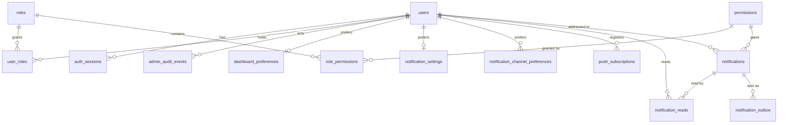

# Data model

The Starter's tables, from the Drizzle schema under `server/database/schema/`. The migration baseline `server/database/migrations/0000_baseline.sql` creates them; the Reference module's table lives in its own migration after the baseline (`0001_demo-tickets`) and is covered at the end. This page lists only what the Starter ships: a Project's domain tables are specified in its own feature spec (the add-domain guide, step 1 and 4).

Conventions for every table (ADR-0006, ADR-0007):

- Primary keys are time-ordered UUIDs from PostgreSQL 18 `uuidv7()`, except where a natural key is named below.
- Timestamps are `timestamptz`, stored in UTC; the app renders them in Tehran time and the User's calendar.
- **Users are never deleted.** Every foreign key to `users` restricts deletion; `disabled` is the only deactivation.
- There is no settings table, no admin settings singleton and no `is_admin` column. A setting lives in the environment, in code or per User (the "where a setting lives" rule in [the add-domain guide](../guides/add-domain.md)).
- Schema changes go through a generated, inspected, committed migration.

## Identity and access

| Table | Purpose | Keys, constraints and indexes |
| --- | --- | --- |
| `users` | The one kind of account. Phone is the identity. | Unique `phone_e164`; CHECK phone format (`+989…`, change it for another country); `status` enum `active` / `disabled`; `is_default_admin`, with a partial unique index so exactly one Default admin exists, and a CHECK that it is never disabled; index `(created_at desc, id desc)` for the newest-first list. Names are optional. |
| `auth_sessions` | Server-side session registry. The cookie holds an opaque token; only its SHA-256 hash is stored. | Unique `token_hash`; index `user_id`; CHECK `absolute_expires_at > created_at`; `idle_expires_at`, `revoked_at`, `revoked_reason`, `user_agent`. FK `user_id` restrict. |
| `otp_challenges` | One active sign-in or phone-change challenge per `(phone, purpose)`. | Partial unique index on `(phone_e164, purpose)` while neither consumed nor invalidated. CHECKs: code is 5 digits or NULL, **the code is NULL once consumed or invalidated**, attempts 0 to 10, expiry after issue. The plaintext code is the accepted exception of ADR-0010; never copy or log it. `user_id` is set only for an authenticated purpose. |
| `otp_send_events` | One row per actual SMS send, for the rolling per-phone and per-IP limits. | Only an HMAC of the IP (`ip_hash`) is stored. Indexes on `(phone_e164, sent_at)`, `(ip_hash, sent_at)`, `(user_id, sent_at)`. Rows older than 24 h are purged. |
| `roles` | Named sets of Permissions. | Unique `name`, and unique `lower(btrim(name))`; `is_super` with a partial unique index so exactly one `super` Role exists. |
| `permissions` | The code-defined Permission catalogue, seeded add-only. | Primary key `key` (text). Never created through the panel. |
| `role_permissions` | Which Role holds which Permission. | Primary key `(role_id, permission_key)`; `role_id` cascades, `permission_key` restricts (so removing a key needs a hand-written migration). |
| `user_roles` | Which User holds which Role. Every User holds at least one. | Primary key `(user_id, role_id)`; both restrict; `assigned_by` (nullable User), `assigned_at`; index on `role_id`. |

## Audit

| Table | Purpose | Keys, constraints and indexes |
| --- | --- | --- |
| `admin_audit_events` | Append-only record of every audited admin action. | `action`, `entity_type`, `entity_id`, `outcome` enum, redacted `change_summary` (jsonb), `reason`, `correlation_id`. FK `actor_user_id` restrict (nullable for system events). CHECK `action` not blank. Indexes `(created_at desc)`, `(entity_type, entity_id, created_at desc)`, `(actor_user_id, created_at desc)`. |

Database trigger (hand-written block at the end of the baseline): UPDATE, DELETE and TRUNCATE on `admin_audit_events` are rejected. A second trigger protects the `super` Role: it cannot be renamed, reduced or deleted. Both survive regeneration of the baseline by re-appending the `hand-written-sql` block verbatim.

## Notifications

| Table | Purpose | Keys, constraints and indexes |
| --- | --- | --- |
| `notifications` | One Inbox item per source event. Visible only to Users who currently hold `required_permission` (checked at read time); when `recipient_user_id` is set, only to that User. | Unique `dedupe_key` (a replay records nothing); FK `required_permission` → `permissions.key` restrict; FK `recipient_user_id` restrict, nullable; `tokens` text array with CHECK ≤ 3; `source_entity_type` / `source_entity_id`; `resolved_at` set when the work ends (reading never sets it). Partial index on `(required_permission, created_at desc)` where unresolved; index on the source. |
| `notification_reads` | Per-User read state. A missing row means unread. | Primary key `(notification_id, user_id)`; notification cascades, user restricts. |
| `notification_outbox` | Transactional outbox: one row per `(event, Channel, address)`, written in the business transaction, delivered later by the worker. | Unique `dedupe_key`; `channel` and `status` enums; `attempt_count` CHECK 0 to 5; `tokens` CHECK ≤ 3; CHECK that the delivered / failed / skipped statuses match their timestamps; lease columns (`leased_until`, `leased_by`); partial index for due rows; retention index. After the retention window the worker nulls `recipient` and `tokens` and sets `payload_purged_at`. OTP codes never appear here. |
| `notification_channel_preferences` | A User's on/off per Channel. A missing row means on; the Inbox cannot be turned off. | Primary key `(user_id, channel)`. |
| `notification_settings` | A User's Message language for every Channel. A missing row means `fa`. | Primary key `user_id`. A preference, never audited. |
| `notification_channel_health` | Circuit-breaker state per Channel. A missing row means operational. | Primary key `channel`; CHECKs on status and a non-negative failure count. |
| `push_subscriptions` | Browsers a User turned Web Push on in (the Web Push + PWA piece). | Unique `endpoint` (a capability URL: never copied into the outbox, logs or audit); `p256dh`, `auth`, `locale_scope`, `device_label`; index on `user_id`. Dropped when the piece is Removed. |

## Per-User preferences

| Table | Purpose | Keys, constraints and indexes |
| --- | --- | --- |
| `dashboard_preferences` | The User's Dashboard arrangement, ranges and Chart style. A missing row means every default; a null `arrangement` means the computed default. | Primary key `user_id`; `arrangement` jsonb, `ranges` jsonb default `{}`, `chart_style` CHECK in `soft` / `glow` / `pro`, `arrangement_updated_at` as the Save conflict version. A preference, never audited. |

## Bookkeeping

| Table | Purpose |
| --- | --- |
| `seed_versions` | Versioned seed bookkeeping: a completed version is never re-run, so edits made in the panel survive deploys. |

## The Reference module

`demo_tickets` (migration `0001_demo-tickets`, schema `server/database/schema/demo-ticket.ts`) is the worked example of a domain table: id, title (CHECK 1 to 200 characters trimmed), description, `status` and `priority` enums, `assignee_id` (nullable, restrict), `created_by` (restrict), `created_at`, `updated_at` (the version for the stale check), `status_since`, with indexes for the newest-first list, `(status, created_at desc)` and the assignee. It is dropped with the migration by `just demo-remove` before a deploy, or by a generated drop migration after one.

## Optional-piece tables

Some tables exist only for an Optional piece (ADR-0029). `push_subscriptions` is listed above; the media piece adds its own object tables, listed in [../optional-pieces/media.md](../optional-pieces/media.md). Each piece's checklist names the tables and the drop migration for its Removed tier.
